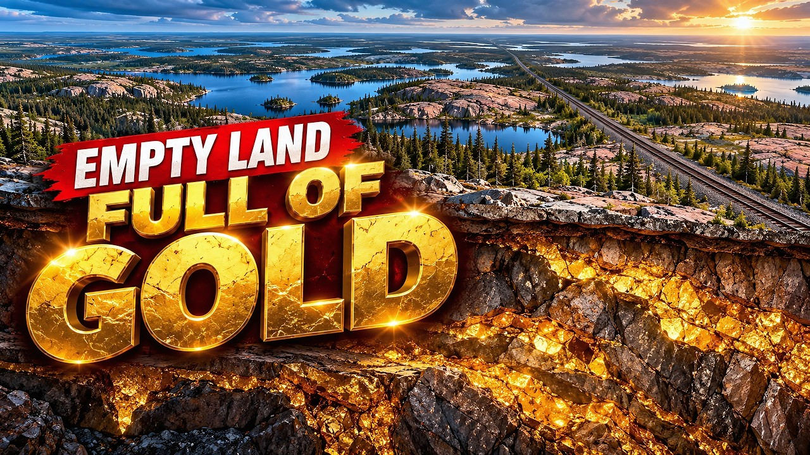

# WHY ALMOST NOBODY LIVES ON THE CANADIAN SHIELD

Half of Canada is almost empty, and the reason is under your feet: a horseshoe of rock billions of years old wrapped around Hudson Bay. Here's how the Canadian Shield decides where Canadians live, and why the emptiest land in the country is also some of the richest.

## Table of Contents

* [00:00:00] A rusty rock beside the railway, 1883
* [00:02:40] The horseshoe of ancient rock
* [00:06:20] The oldest rocks on Earth and the mountains that vanished
* [00:11:20] What the ice sheet took away
* [00:13:50] Why you can't farm the Shield: the Clay Belt gamble
* [00:17:20] Living without fields: canoes and portages
* [00:21:00] The railway the muskeg swallowed
* [00:24:20] Where the Shield ends and Canada's cities begin
* [00:27:50] Gold, uranium and diamonds
* [00:33:00] Mining towns and 237,000 tonnes of arsenic
* [00:36:20] Hydro power, the Ring of Fire and the rusty rock's secret

## [00:00:00] A rusty rock beside the railway, 1883

August 1883, north of Lake Huron. The Canadian Pacific Railway is being pushed west through a land of bare rock, black spruce, and lakes that nobody has bothered to map properly. A blacksmith named Tom Flanagan walks along a freshly cut slope where the crews have been blasting, and he stops. The rock under his boots is rust-colored, like an old nail left out in the rain. Dear viewers, please hit like on this video and subscribe to our channel with the notification bell. [00:00:00 → 00:00:33]

And now, let's carry on. He takes a few samples. A few months later, in February of 1884, two brothers named Thomas and William Murray stake a claim on that spot. They buy the land for $310. That works out to $1 an acre. [00:00:33 → 00:00:51]

Hold on to that rusty rock, because we'll come back to that exact slope at the very end, and you'll find out what it really was. The land around Flanagan's rusty rock still looks almost as empty today. Take Northern Ontario. It covers close to 9/10 of the province, depending on where you draw the line. Yet, out of every 100 Ontarians, only about six live there. [00:00:51 → 00:01:15]

Up north, there's roughly one person for every square kilometer. Picture about 140 soccer pitches laid side by side with one single person standing on all of them. Across Ontario as a whole, that same patch of ground holds 132 people. It's not just Ontario, either. Statistics Canada says about two out of every three Canadians live within 100 km of the American border. [00:01:15 → 00:01:42]

You may have heard an even bigger number, 90%, but that figure is an outside estimate, and it doesn't hold up well. The real number is dramatic enough. So, here's the question. Why does half of this country stay almost empty? And why did a real city grow up on the exact spot where a blacksmith found rusty rock. [00:01:42 → 00:02:03]

Before we get there, here's what's ahead. You'll see rocks that one team of scientists dated in 2025 to about 4. 16 billion years. That's very nearly the age of the planet itself, and the argument over that number isn't settled. You'll see a railway where the ground swallowed track, rail cars, and hundreds of car loads of gravel. [00:02:02 → 00:02:25]

By one estimate, a single mile of it cost $700,000 in 1880s money. You'll visit a northern city sitting on top of 237,000 tons of arsenic, which Canada plans to keep frozen for at least 100 years. [00:02:25 → 00:02:42]

## [00:02:40] The horseshoe of ancient rock

And at the end, there's a swamp named after a Johnny Cash song. In October 2026, Ottawa promised a billion dollars to build roads into it. That's where the rusty rock finally gets explained. To see why the north is empty, you have to look at what's under it. Pull up a map of Canada and tilt it into three dimensions. [00:02:41 → 00:03:02]

Now, lay one shape over it. It starts in the far northwest, around Great Bear Lake and Great Slave Lake in the Northwest Territories, and runs across most of Nunavut. It sweeps down through northern Saskatchewan and Manitoba, covers almost all of northern Ontario, takes in nearly all of Quebec north of the St. Lawrence, and runs right out to Labrador. In the middle of it, like water pooled in a bowl, sits Hudson Bay. [00:03:02 → 00:03:31]

That shape is a huge horseshoe of ancient rock wrapped around the bay. Geologists call it the Canadian Shield. According to the Canadian Encyclopedia, the Shield covers about 5 million square kilometers of Canada. That's roughly half the country's land. 5 million square kilometers is hard to picture. [00:03:29 → 00:03:50]

So, try this. You could fit all of Ontario inside it, then Quebec, and still have room for Alberta and Saskatchewan both. The Shield doesn't stop at the border, either. It runs into the northern United States and under Greenland and by some estimates the whole thing comes to around 8 million square kilometers. The Canadian half alone is what shapes this story. [00:03:50 → 00:04:14]

What makes it a shield? In most places the oldest rocks of a continent are buried. They sit deep down under kilometers of younger layers of sandstone, limestone, shale, and soil laid down over hundreds of millions of years like a quilt on a bed. That's the case under southern Ontario, under the prairies, under the St. Lawrence Valley. [00:04:12 → 00:04:37]

Here, across the shield, that quilt is mostly gone. The bed is bare. What you're standing on in Sudbury, in Thunder Bay, in Yellowknife is the hard old core of North America itself, right at the surface. Geologists call these rocks Precambrian. In plain terms, that means they formed before complex animal life took off on Earth. [00:04:37 → 00:05:02]

We're talking hundreds of millions of years older than the first dinosaurs and in many places billions of years older. When you put your hand on a pink granite outcrop beside a highway in northern Ontario, you're very often touching rock that was already ancient when the first fish swam. Now add the second layer to the map. Take the same three-dimensional Canada and light it up according to where people actually live. The south glows. [00:05:01 → 00:05:28]

There's a bright band from Windsor through Toronto and Ottawa to Montreal and Quebec City. There are bright dots in the west at Winnipeg, Saskatoon, Calgary, Edmonton, and Vancouver. Then look north. Over the horseshoe of the shield, the lights go dim. You see a few dots strung along a railway or a highway, a mining town here, a First Nations community there, and then hundreds of kilometers of near darkness. [00:05:28 → 00:05:57]

Flip back and forth between the two layers and something strange happens. The dark patch of population and the outline of the shield line up almost perfectly. The empty half of Canada is the shield. That can't be a coincidence, and it isn't. But to understand why rock decides where people live, you first need to know how old this rock really is and what it went through. [00:05:56 → 00:06:23]

## [00:06:20] The oldest rocks on Earth and the mountains that vanished

Here the scientists start to argue. Some of the oldest rocks ever dated on this planet sit right here inside the horseshoe. One set in the Northwest Territories comes in at about 4. 03 billion years. Another on the shore of Hudson Bay in Quebec has been dated to 4. [00:06:21 → 00:06:43]

16 billion, and not everyone accepts that number. Next we'll get into how these rocks were born, how they collided and built mountains as tall as the Himalayas, and how those mountains vanished. Remember where Flanagan was standing in 1883? That rusty slope sits right near the southern edge of this horseshoe, and there's a reason it's there, not 100 km away. We're not there yet. [00:06:43 → 00:07:07]

Walk up to almost any rock cut on Highway 11 or Highway 17 and look closely. You'll often see pink and gray granite, sometimes speckled like salt and pepper. Or you'll see something stranger. Rock striped in wavy bands of light and dark, like a marble cake that someone squeezed in a giant fist. That banded rock is called nice, and the bands tell you it was cooked and crushed deep inside the earth before it ever saw daylight. [00:07:07 → 00:07:37]

Granite and nice make up most of the shield. They're hard, they're crystalline, and they're old. How old? This is where the story gets wild. The shield wasn't built in one go. [00:07:35 → 00:07:49]

It's a patchwork of very old pieces of crust that geologists call cratons. You can think of them as the first rafts of solid land that floated on a young, hot planet. The biggest one in Canada is the Superior Craton, which sits under most of northern Ontario and western Quebec. Up in the Northwest Territories, there's the Slave Craton. Across northern Saskatchewan, Manitoba, and Nunavut, there are others called the Hearne and the Rae. [00:07:49 → 00:08:18]

Inside the Slave Craton, north of Yellowknife, there's an outcrop called the Acasta Gneiss. It has been dated to about 4. 03 billion years. For decades, it was the champion, the oldest dated rock on Earth. Then came a challenger. [00:08:18 → 00:08:36]

On the eastern shore of Hudson Bay in northern Quebec, near the Inuit community of Inukjuak, there's a strip of rock called the Nuvvuagittuq belt. Back in 2008, one team claimed it was about 4. 3 billion years old. Other geologists pushed back hard, saying the dating method couldn't be trusted that far. So, in 2025, a team tried again, publishing in the journal Science. [00:08:34 → 00:09:02]

This time, they dated younger molten rock that had forced its way into the belt. The logic was simple. If that intruding rock is a certain age, the rock it cut through has to be at least that old. They used two separate dating methods, and both came back at about 4. 16 billion years. [00:09:00 → 00:09:19]

That's not quite the end of the argument. Outside scientists said it isn't clear yet whether Nuvvuagittuq will be widely accepted as the oldest rock on the planet. What we can say is that two of the strongest candidates for the oldest rock anyone has found are both in Canada, and both sit inside the shield. If you're enjoying this trip into very deep time, give the video a like, subscribe, and tap the bell so you don't miss what's coming. Now, back to those ancient rafts. [00:09:19 → 00:09:48]

The cratons didn't stay put. They drifted, and eventually they crashed into each other. The biggest crash came roughly 2 billion to 1. 8 billion years ago. The Superior Craton in the east slammed into the Hearne and Rae Cratons to the west. [00:09:48 → 00:10:07]

Caught in between were smaller scraps of crust, island chains, and even a buried block geologists call the Sask Craton. The collision zone is known as the Trans-Hudson Orogen, which is just a geologist's way of saying a belt of mountains made by plates colliding. It runs from northern Saskatchewan and Manitoba up around Hudson Bay toward Baffin Island. The University of Regina's Encyclopedia of Saskatchewan describes it as the largest mountain belt of its era anywhere in the world. When it formed, those mountains would have rivaled the Himalayas. [00:10:05 → 00:10:41]

Picture Everest-sized peaks standing over what's now Flin Flon and La Ronge. Today, drive through that country and you'll see lakes, spruce, and low rocky ridges. You won't find a single mountain. Where did they go? Rain, frost, rivers, and wind took them apart a grain at a time for well over a billion years. [00:10:41 → 00:11:03]

Every peak was worn down until only the roots were left. The deep rock that had once sat kilometers below the summits. Those roots are what you're looking at when you see banded nice in a highway cut. You're standing in the basement of a mountain range that no longer exists. [00:11:03 → 00:11:22]

## [00:11:20] What the ice sheet took away

Further east, much later, roughly a billion years ago, another mountain-building collision added a strip along the southeastern edge of the shield. That strip runs through Ontario's cottage country and up the north shore of the St. Lawrence. Those mountains got ground down, too. So, by the time the dinosaurs showed up, the shield was already a huge, worn, flat plain of very old, very hard rock. [00:11:20 → 00:11:48]

Then, much more recently, the climate turned cold and snow started piling up over the middle of the continent faster than summer could melt it. Year after year, it packed down into ice. That ice started to spread, and it grew into a sheet that would bury almost all of Canada. Over Hudson Bay, that ice grew 3 to 4 km thick. Next, you'll see what that weight did as it slid across the shield. [00:11:46 → 00:12:14]

It's the reason a farmer up here still loses to the land today. And the rusty slope from 1883 is still waiting for its answer. Imagine a block of ice as tall as eight CN Towers stacked one on top of another sitting on the earth. Now stretch it out until it covers nearly all of Canada. That's roughly what the Laurentide Ice Sheet was at its peak. [00:12:14 → 00:12:39]

Models of the ice put it at about 3 and 1/2 km thick west of Hudson Bay and close to 4 km to the east. And it wasn't sitting still. Ice that thick flows outward under its own weight like pancake batter spreading in a pan only far slower. As it moved, it dragged along everything that wasn't nailed down. Think about what was lying on top of the shield before the ice came. [00:12:37 → 00:13:05]

Over millions of years, rock had weathered into loose rubble, sand, clay, and soil. The kind of ground plants can root in. The ice picked all of that up. It froze boulders and gravel into its base and used them like sandpaper grinding across the bedrock for thousands of years. When the ice finally melted back, much of the shield had been scraped down to bare stone. [00:13:05 → 00:13:30]

Go to Killarney or Georgian Bay and you can still see the scratches. Long straight grooves cut into the rock all running the same way like claw marks pointing in the direction the ice traveled. Where did all that soil go? A lot of it was pushed south and dumped along the edges of the ice sheet. Some of the best farmland in southern Ontario and the American Midwest is built on material the ice carried away from the north. [00:13:28 → 00:13:55]

## [00:13:50] Why you can't farm the Shield: the Clay Belt gamble

So the shield didn't just lose its soil. In a sense, the south received it. What the ice left behind on the shield was a thin patchy layer of sand, gravel, and boulders called till spread over hard rock. Then there were the hollows. Ice and meltwater dug out softer zones and cracks in the bedrock And when the ice retreated, water filled them. [00:13:55 → 00:14:20]

That's why the shield looks the way it does from a plane. Rock, trees, and lakes. Lakes and more lakes. A jigsaw puzzle of blue as far as you can see. Nobody has a firm count because it depends on how small a pond you're willing to call a lake, but the number runs into the hundreds of thousands. [00:14:18 → 00:14:40]

One of those meltwater lakes was enormous. As the ice sheet melted, a giant body of water called Lake Ojibway pooled against its southern edge across what's now northeastern Ontario and northwestern Quebec. It finally drained around 8,200 years ago. When it emptied, it left something unusual on the shield. A wide, flat floor of thick clay. [00:14:38 → 00:15:06]

Keep that clay in mind because the government is about to bet on it. Before we get there, if you're finding this useful, a quick like, a subscription to the channel, and a tap on the bell help us keep making these. Right, back to the dirt. So, why can't you just farm the shield? Start with the soil itself. [00:15:04 → 00:15:22]

Where there is soil, it's mostly what scientists call podzolic soil. These are forest soils that formed on sandy glacial material made from granite type rock. That material is naturally acidic. It drains fast, so water doesn't stay, and nutrients wash straight down past the reach of a crop's roots. Under the spruce needles, you'll often find a pale, ashy gray layer. [00:15:22 → 00:15:47]

That's soil that has been leached nearly bare. It's fine for a boreal forest that has adapted over thousands of years. For wheat, it's poor. Then there's the rock. In many places, the soil is only a few centimeters deep before you hit solid granite. [00:15:47 → 00:16:03]

You can't plow that, and you can't drain it. Between the ridges, the low ground fills with water and turns into bog. On top of all that, the growing season is short. Up north, frost comes early in the fall and hangs on late into spring. That's why the bands of farmland in Canada stop where they do. [00:16:03 → 00:16:26]

On a three-dimensional map, the fields of southern Ontario and the St. Lawrence Valley run right up to the edge of the shield, and then they stop, as if someone drew a line with a ruler. North of that line, the forest takes over. Except in one place. Remember the clay floor of old Lake Ojibway? [00:16:24 → 00:16:46]

It became known as the Great Clay Belt, a half-moon of flat, heavy clay stretching across the Ontario and Quebec border country. Unlike the rest of the shield, it was deep, level, and stone-free. To officials in the south, it looked like a second chance. A government report in 1899 praised it as fertile, flat land close to the new logging and mining camps. On the Quebec side, French-Canadian families had been encouraged to settle and farm since the 1880s. [00:16:46 → 00:17:18]

After the First World War, Ottawa's Soldier Settlement Board set up a colony at Kapuskasing so returning veterans could start new lives as farmers. [00:17:15 → 00:17:27]

## [00:17:20] Living without fields: canoes and portages

On paper, it was the north's breadbasket. Next, you'll see what the climate did to that dream, and then how people lived on the shield for thousands of years without planting a single field. The rusty rock is still waiting. The first winters in the clay belt hit the settlers hard. The ground was flat and the clay was deep, just as the reports had promised. [00:17:27 → 00:17:48]

But the land was still way up on the shield, and the climate didn't care about government brochures. Summers were short, winters were long and buried everything in snow. Rain came at the wrong time, or not at all, or all at once. Heavy clay that soaked through turns into a sticky trap, and when it dries, it bakes hard. Most families got very little out of their fields. [00:17:48 → 00:18:11]

Some farmers gave up and moved back to the cities of the south. By around 1935, new settlers had all but stopped coming. What the Clay Belt really became was logging country with pulp mills where the wheat was supposed to be. Canada had made a deliberate, organized effort to farm the Shield, and the Shield won. So, here's the obvious question. [00:18:11 → 00:18:36]

If you can't farm this land, how did anyone live on it? People had been living across the Shield for thousands of years before the first settler ever showed up with a plow. The Cree lived across the north from Quebec through Ontario and Manitoba and into Saskatchewan. The Anishinaabe, including the Ojibwe, lived around the Upper Great Lakes and the lakes and rivers west and north of them. Further north, on the treeless tundra at the top of the Shield, were the Inuit. [00:18:36 → 00:19:06]

None of them built their lives around fields. They lived by hunting, fishing, and gathering, and above all, by moving with the seasons to where the food was. The thing that made that possible is the thing that makes the Shield so hard to cross by road. All that water. To a farmer or a road builder, 100,000 lakes are an obstacle. [00:19:04 → 00:19:26]

If you have the right boat, they're a highway. That boat was the birch bark canoe. The Canadian Encyclopedia describes it as built to be light and easy to repair on the move. If you tore the skin on a rock, you could patch it on the shore with bark, roots, and spruce gum. It floated in shallow water, handled fast rivers, and when the river ended, one or two people could lift it and carry it to the next lake. [00:19:26 → 00:19:55]

That carry is called a portage, and portages are the hidden roads of the Shield. The Canadian Encyclopedia notes that indigenous peoples built and kept up these trails for generations before Europeans arrived. String the lakes and portages together, and you could travel thousands of kilometers across the Shield without a single road. Let's take a quick breather. If you're enjoying the story, show it some love with a like. [00:19:53 → 00:20:20]

Subscribe if you haven't, and tap the bell for the next one. Now, back on the water. When the fur trade arrived, the traders from Montreal and the Hudson's Bay Company didn't invent new routes. They used the ones that were already there. Some of the famous portages became turning points of the whole continent. [00:20:18 → 00:20:39]

Grand Portage, at the western end of Lake Superior, connected the Great Lakes and the St. Lawrence to the rivers draining toward Hudson Bay. Methye Portage, in what's now northwestern Saskatchewan, crossed a height of land into the Athabasca country, where the rivers flow north to the Arctic Ocean. Cree and Nakoda peoples got early access to Hudson's Bay Company trade goods and became middlemen moving furs and goods along these water routes. [00:20:37 → 00:21:07]

## [00:21:00] The railway the muskeg swallowed

The French Canadian voyageurs took the canoe to an industrial scale. The big Montreal canoe, the canot du maître, carried a crew of six to 12 paddlers and about 2,300 kg of cargo. That's about the weight of a big pickup truck. And they took it from Montreal to Lake Superior in a canoe made of bark, carried on their backs around every waterfall. So, the Shield wasn't empty because nobody could live there. [00:21:05 → 00:21:33]

Small groups lived there very well, moving lightly across the land. What it couldn't support was the kind of settlement the newcomers wanted, >> [music] >> farms, towns, and railways. That's where things got expensive. In the early 1880s, Canada set out to build a railway from sea to sea. And between the farms of the east and the open prairies of the west lay the north shore of Lake Superior. [00:21:33 → 00:21:59]

It's the Shield at its most stubborn. Granite ridges drop straight into the lake. Every few kilometers, there's another river gorge to bridge. And a canoe can be carried, but a railway has to go straight through. The crews of the Canadian Pacific Railway blasted cut after cut through solid rock. [00:21:56 → 00:22:18]

In the low ground between the ridges, they met something even worse than granite, muskeg. It's a boreal bog, a deep spongy mat of moss and peat floating on water with a surface that can look perfectly solid. Next, you'll see what muskeg did to the railway. It swallowed track, swallowed rail cars, and ate hundreds of carloads of gravel. By one estimate, 1 mile cost $700,000. [00:22:15 → 00:22:47]

And somewhere along that same line, a blacksmith was about to notice that rusty patch of rock. The ground looked solid. That's what made it so dangerous. Along the north shore of Lake Superior, the railway crews would lay track across what seemed like firm, mossy, flat land. Then the muskeg underneath would give way. [00:22:45 → 00:23:09]

Long stretches of rail sank out of sight. Rail cars went down with them. The crews dumped gravel in to build a base, and the bog swallowed it. Hundreds of carloads without filling up. Where trestles crossed soft ground, they kept sinking, and they had to be reinforced again and again. [00:23:07 → 00:23:27]

Between the bogs was the opposite problem. Rocks so hard and so steep that the line had to be blasted through it. Cut after cut, tunnel after tunnel. The railway needed so much explosive that it set up factories to make dynamite right on the spot at enormous cost. Here's what that meant in dollars. [00:23:26 → 00:23:50]

By one estimate, one single mile along this shore cost $700,000 to build, and several others cost around half a million each. Treat those as rough numbers from later histories, but even the more modest records are startling. The short stretch around Jackfish, with its three tunnels, came to about $1. 2 million in money of the 1880s. By early 1885, the Canadian Pacific Railway was close to financial ruin. [00:23:47 → 00:24:18]

The shield was literally eating the company's money. [00:24:18 → 00:24:21]

## [00:24:20] Where the Shield ends and Canada's cities begin

On May 16th, 1885, near Jackfish, the crews finally drove the spike that closed the gap on the Lake Superior section. The rails were joined, but the rock had made its point. Fast forward 75 years. Canada has cars now, and it wants a highway from coast to coast. Once again, the hardest piece is the same stretch of shield. [00:24:21 → 00:24:46]

Between Sault Ste. Marie and the north shore of Lake Superior lay a stretch of wilderness 266 km long that people simply called the gap. Before the highway, if you lived in Wawa, you got in and out by steamboat on Lake Superior until that service ended in 1941 or by the Algoma Central Railway, which reached town in 1921. There was no road. The gap turned out to be the most expensive section of the Trans-Canada Highway in all of Ontario. [00:24:46 → 00:25:18]

The last link was finally finished at Wawa on September 17th, 1960, and the whole Trans-Canada Highway was officially opened in 1962. You'll sometimes hear that Highway 17 around Lake Superior is the only road tying Eastern and Western Canada together. That's not quite true. There's a northern route, too, through Kapuskasing and Hearst. But think about what that tells you. [00:25:16 → 00:25:45]

In the second largest country on Earth, the road network across this whole region comes down to a couple of strands of asphalt laid through rock, bog, and lake. Before we zoom out to the big picture, a quick favor. If this is opening your eyes to the map, hit the like button, subscribe, and turn on the bell. Now, let's pull back and look at where the shield ends. Go back to the three-dimensional map. [00:25:42 → 00:26:10]

Follow the southern edge of the shield and watch what happens to the land. South of it, the old granite doesn't disappear. It dives underground. On top of it lie younger layers of sedimentary rock, limestone, sandstone, and shale laid down in shallow seas long after those ancient mountains had worn away. That's the bedrock of Southern Ontario's Great Lakes lowlands and of the St. [00:26:08 → 00:26:36]

Lawrence Valley through Montreal and Quebec City. It's flatter, the soil is deeper, and much of it is the soil the glaciers scraped off the north and dumped here. There's one spot where you can actually see the two worlds meet. Near Kingston, the shield sends a narrow arm of granite south right across the St. Lawrence River. [00:26:34 → 00:26:54]

That arm is called the Frontenac Axis and it runs on into the Adirondack Mountains in New York State. When you boat through the Thousand Islands, those rocky, pine-covered islands are the tops of shield ridges poking out of the river. The shield's edge is right there in one of the most visited places in Eastern Canada. Now, switch on the population layer again. The farms, the highways, the dense string of towns from Windsor to Quebec City sit almost entirely on the younger sedimentary rock. [00:26:54 → 00:27:29]

The moment the bedrock turns to shield, the lights thin out. In Ontario, it's brutally clear. The sedimentary south holds about 94 out of every 100 Ontarians. The shield north, which covers almost 9/10 of the province, holds the other six. The same pattern shows up out west. [00:27:27 → 00:27:47]

Winnipeg sits on flat prairie and drive east toward Kenora and within a couple of hours you're on the pink granite and lakes and the farm fields are gone. [00:27:47 → 00:27:58]

## [00:27:50] Gold, uranium and diamonds

In Quebec, nearly everyone lives in the strip along the St. Lawrence with the shield looming over the north shore. So, the line where people stop isn't a line of climate alone and it isn't an accident of history. It's a line in the rock. And the empty half has something the fertile south doesn't: gold, nickel, uranium, diamonds. [00:27:56 → 00:28:20]

The diamonds were found by following a trail left by that same glacier. The rusty rock from 1883 still hasn't been explained. So, that's the first half of the answer. Half of Canada is nearly empty because the ancient core of the continent sits naked at the surface there. The ice scraped it clean, the soil is thin and sour, the ground between the ridges is bog, and every kilometer of road or rail costs a fortune. [00:28:18 → 00:28:48]

People settled on the younger rock to the south, where the ground let them farm and build. But there's a catch, and it's the best part of the story. The rock that made the shield so useless for farming is also some of the richest rock on the planet. Start in the fall of 1909 in the bush of northeastern Ontario near a place called Porcupine Lake. Prospectors are stumbling over quartz glittering with gold. [00:28:47 → 00:29:12]

Who found it first? That depends on who's telling it. One version credits Jack Wilson and Harry Preston, and a popular story says Preston slipped on some moss, scraped it off with his boot, and uncovered gold underneath. Another version points to a young prospector named Benny Hollinger, who staked his claim in October of that year. The historical records don't line up neatly with any of these stories. [00:29:12 → 00:29:37]

So, the honest answer is that we're not sure. What's certain is what came next. Within a couple of years, the Porcupine gold rush was in full swing. By 1912, three great mines were running: the Dome, the Hollinger, and the McIntyre, together known as the Big Three. Behind the Hollinger was Noah Timmins, who had already made his money on silver at Cobalt further south. [00:29:37 → 00:30:03]

In 1912, a new town was incorporated in the bush and named after him. Today, Timmins is one of the biggest cities in northern Ontario, built on gold pulled out of the shield. A little to the east at Kirkland Lake, prospectors went to work on the gold there from 1911. By the 1920s, four substantial gold mines were operating on a single short stretch of ground, and between them, on that same southern edge of the shield, sits Sudbury, the nickel capital of Canada, born from Tom Flanagan's rusty rock. We'll get to why it's there. [00:30:03 → 00:30:40]

If this is the kind of story you love, give the video a like, subscribe to the channel, and click the bell. Now, let's head west to something more powerful than gold. In far northern Saskatchewan, part of the shield is covered by a thick layer of sandstone called the Athabasca Basin. Down where that sandstone sits on top of the old shield rock, nature concentrated uranium into some of the richest deposits ever found. Two mines stand out, McArthur River and Cigar Lake. [00:30:38 → 00:31:12]

Typical uranium ore around the world is mostly rock with just a trace of the valuable stuff. At these two mines, the ore averages around 15% uranium oxide. Cameco, which runs them, says that's roughly 100 times the world average. Here's what 100 times means. A truckload of rock from northern Saskatchewan holds about as much uranium as 100 truckloads from an ordinary mine somewhere else. [00:31:10 → 00:31:38]

Sources disagree on which of the two is richer, but between them they put a patch of empty Saskatchewan bush at the center of the world's uranium business. Then there are diamonds, and this is where the glacier comes back into the story. In 1980, two geologists named Chuck Fipke and Stu Blusson started hunting for diamonds in the Northwest Territories. Diamonds come up from deep in the earth inside narrow pipes of a rock called kimberlite. In the Arctic, those pipes are hidden under lakes and tundra. [00:31:36 → 00:32:10]

So, how do you find a hole in the ground the size of a city block in a wilderness bigger than most countries? You follow the ice. When the ice sheet ground across the tops of those pipes, it picked up crumbs of the rock and smeared them out along its path, like a trail of breadcrumbs pointing back to where they came from. Fipke and Blusson sampled glacial sand and gravel, picking out tiny telltale minerals that travel with diamonds. Where the minerals were more common, they were getting closer. [00:32:08 → 00:32:40]

Where they disappeared, they'd gone too far. Year after year, they worked their way back up the trail against the direction the ice had flowed. It took more than a decade. Then, in 1991, together with their partner BHP, they announced it. Diamonds in a sample of rock from Lac de Gras, about 250 km northeast of Yellowknife. [00:32:40 → 00:33:04]

## [00:33:00] Mining towns and 237,000 tonnes of arsenic

It set off one of the greatest staking rushes in Canadian history. With prospectors flying in to claim every scrap of tundra they could. Canada's first diamond mine, Ekati, opened in 1998. Diavik, just 25 km away, started producing in 2002. The same ice that stripped the shield of its soil and made it hopeless for farmers had quietly drawn the map to its diamonds. [00:33:02 → 00:33:31]

Gold, uranium, diamonds. Wherever a deposit like this turns up, a town springs up beside it. But what happens when the ore runs out? Next, we'll go to a town named after a character in an old adventure novel, and to Yellowknife, where 237,000 tons of arsenic are being kept frozen underground. And the rusty rock from 1883 is still waiting for its answer. [00:33:31 → 00:34:00]

Picture a prospector in the bush of northern Manitoba in 1915 with a cheap paperback in his pack. The book is The Sunless City, an adventure novel about a man who sinks to the bottom of a lake and finds a world full of gold. The hero has a gloriously silly name, Josiah Flintabbatey Flonatin. That year, prospectors found a big body of ore near the Manitoba-Saskatchewan border. The story usually credits Tom Creighton with naming the find after the novel's hero, shortened to Flin Flon. [00:33:58 → 00:34:33]

Sources can't agree on when the novel came out, and the city itself admits its origin story mixes fact and fiction. Either way, the name stuck. In 1927, Hudson Bay Mining and Smelting was founded to work the deposit, and a town grew up right on the bare rock around the mine, all because of what was underneath. That's how the Shield got its towns. People didn't come for the land, they came for what was under it. [00:34:33 → 00:35:02]

When the ore runs low, the reason to stay starts running out, too. Some mines leave more than an empty town behind. Go north to Yellowknife. From 1948 to 2004, Giant Mine pulled gold out of the Shield there. To get the gold out, the ore was roasted, and the roasting gave off a toxic dust called arsenic trioxide. [00:34:59 → 00:35:25]

Starting in 1951, that dust was blown into chambers and old workings underground, and it kept piling up for decades. Today, there are 237,000 tons of it down there, right next to the capital of the Northwest Territories. The government's solution sounds like science fiction. Freeze it. Big pipes called thermosiphons pull heat out of the ground, so each chamber gets wrapped in a frozen shell of rock at minus 5° or colder. [00:35:23 → 00:35:54]

The plan is to keep it frozen for at least 100 years. The cleanup is expected to cost around a billion dollars, and the underground mine was sealed off in late 2024. So, the Shield gives, and it also takes. Mines built towns up here, but they never filled the north with people the way farms filled the south. If you've stuck with us this far, thank you. [00:35:54 → 00:36:17]

A like, a subscription, and a tap on the bell would mean a lot. [00:36:17 → 00:36:23]

## [00:36:20] Hydro power, the Ring of Fire and the rusty rock's secret

Now, for what the Shield is turning into today. The first thing is water. The same hard rock that made railways so expensive gives rivers solid ground to fall over, and the ice left those rivers with plenty of steep drops. In northern Quebec, the La Grande Complex near James Bay generates somewhere around 15 to 16 and 1/2 gigawatts, depending on how you count. That's nearly half of everything Hydro-Québec can produce. [00:36:23 → 00:36:53]

In Labrador, Churchill Falls adds about 5,400 MW, and a new plant at Gull Island, about 2,250 MW, is planned for around 2034, once the two provinces finalize the deal. Big parts of Canada keep the lights on with power from the Shield. The second thing is minerals, and this is where it gets heated. About 500 km northeast of Thunder Bay, near McFaulds Lake, lies a flat expanse of muskeg with no year-round road anywhere near it. In 2002, exploration there turned up copper and zinc. [00:36:50 → 00:37:32]

Then, on August 28th, 2007, a company called Noront announced a high-grade find of nickel, copper, platinum, and palladium. Prospectors piled in. The head of Noront, Richard Nemis, was a lifelong Johnny Cash fan, and the area got its name from Cash's famous song. The Canadian Encyclopedia says Nemis came up with it together with geologist John Harvey and financier Robert Cudney. Either way, northern Ontario now has its own Ring of Fire. [00:37:28 → 00:38:01]

Beneath that bog lie chromite and nickel, the kind of metals the world now calls critical for steel, batteries, and electric cars. The problem is the same one the railway builders faced in the 1880s, muskeg. You can't move ore out of a swamp without a road. On October 21st, 2026, Prime Minister Mark Carney announced that Ottawa would match Ontario's billion dollars for roads into the Ring of Fire. That's two billion dollars to cross a bog. [00:38:01 → 00:38:34]

Ontario has signed partnerships with three First Nations that want the road. Many other communities in the region are firmly against it. Construction on the access roads was reported to have begun in June of this year, and a key environmental decision on one of the roads is expected by the end of 2026. Will it change the map of where Canadians live? Probably not the way the South was changed. [00:38:32 → 00:38:56]

Mines up here tend to bring fly-in camps and a handful of towns, not new cities and farm belts. The rock still sets the terms. That brings us back to where we started. August 1883. A blacksmith named Tom Flanagan, a fresh railway cut, and a patch of rusty rock. [00:38:56 → 00:39:17]

Here's what was under his boots. Around 1. 85 billion years ago, a body from space slammed into the southern edge of the Superior Craton. Zircon crystals from the rock it melted have been dated to about 1,849 million years. The crater may have been 200 to 250 km across, though the estimates vary. [00:39:15 → 00:39:41]

Later, mountain building squeezed what was left into the oval you see today, about 60 km long and 30 wide, called the Sudbury Basin. The impact melted the crust into a sea of molten rock. By one estimate, about 31,000 cubic kilometers of it. As that melt cooled, heavy metal-rich sulfides sank and collected along its floor and seeped into cracks below it. Nickel, copper, and platinum group metals. [00:39:39 → 00:40:10]

Isotope studies suggest those metals came mostly from Earth's own crust, not from the space rock. The impact didn't bring the treasure. It melted the ground and gathered the metal into one place. Where those sulfides reached the surface, air and water rusted them. That's what Flanagan saw. [00:40:08 → 00:40:28]

At first, everyone thought it was copper. It took a few more years for someone to realize the ore was also rich in nickel. And the land the Murray brothers bought for a dollar an acre sat on top of one of the greatest nickel deposits on Earth. The shield sent Canadians south to live. And it gave Sudbury a reason to exist. [00:40:28 → 00:40:49]

It started with one rusty slope beside a railway line. >> [music] [00:40:46 → 00:40:56]
