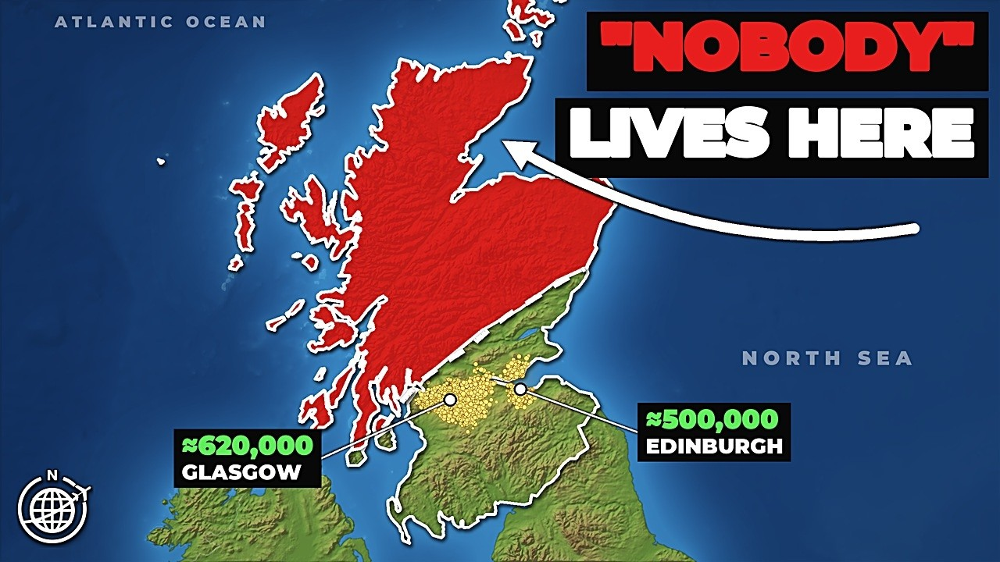

# Why Almost Nobody Lives in Most of Scotland

Scotland has about 5.4 million people, yet roughly seven in ten live in one narrow band between Glasgow and Edinburgh. North of it lies a single council area bigger than the whole of Wales, with fewer than half as many people as the city of Edinburgh. So what emptied the Highlands: the rock, the wea

## Table of Contents

* [00:00:00] Intro
* [00:00:44] 1. A land of clans
* [00:01:35] 2. The battle that ended the clans
* [00:02:28] 3. The Clearances
* [00:03:34] 4. Hunger and the ships
* [00:04:44] 5. The line across Scotland
* [00:05:50] 6. Ice, rock and peat
* [00:06:58] 7. The rain wall
* [00:08:10] 8. Deer forests and the four hundred
* [00:09:20] 9. Coal under the valley
* [00:10:17] 10. Scotland, city by city
* [00:11:18] 11. The glens fight back
* [00:12:18] Closing

## [00:00:00] Intro

Why does almost nobody live in most of Scotland? From the air, it looks like a country made for people. Deep glens, long sea lochs, rivers full of salmon, and more fresh water than it could ever use. Scotland is home to around 5. 4 [music] million people. [00:00:00 → 00:00:15]

But look at where they live. Roughly seven in 10 are squeezed into [music] one narrow band between Glasgow and Edinburgh. North of it lies a single council area bigger than the whole of Wales with fewer than half as many people as the city of Edinburgh. So what emptied the Highlands? Was it the rock, the weather, or the people who owned the land? [00:00:15 → 00:00:36]

By the end, you'll see how one straight line on the map explains [music] almost all of it. This is Unlikely Latitudes, and this is the hidden geography of empty Scotland. [00:00:34 → 00:00:46]

## [00:00:44] 1. A land of clans

For most of its history, the Highlands weren't empty at all. If you'd walked up a Highland glen in 1740, you'd have heard voices, dogs, and cattle. Glens that are silent today were once lined with townships, [music] little clusters of stone houses, shared fields, and cattle grazing on the hills [music] above. Families belonged to clans, and a chief's power was measured less in money than [music] in men. How many fighters he could call out of the glens. [00:00:44 → 00:01:13]

In the mid-1700s, the Highlands and islands held a far bigger share of Scotland's people than they do today. But life was a constant struggle. Harvests were small, summers were short, and one wet year meant hunger [music] by spring. People lived close to the edge, yet they lived there in the thousands. [music] So what changed? [00:01:11 → 00:01:32]

It started with one battle on a cold moor near Inverness. [00:01:32 → 00:01:38]

## [00:01:35] 2. The battle that ended the clans

On the 16th of April, 1746, the Jacobite [music] army of Charles Edward Stuart, better known as Bonnie Prince Charlie, met government troops at Culloden, just east [music] of Inverness. It was over in about an hour. The Jacobites were crushed, and what followed changed the Highlands for good. The government set out to make sure the clans could never rise again. It banned Highland dress and tartan, stripped the chiefs of their old legal powers and pushed new roads and forts deep into the glens. [00:01:35 → 00:02:06]

But the biggest change was quieter. If you were a chief without a private army, [music] you no longer needed hundreds of fighting men. What he needed was money. And to a landowner short of cash, a glen full of tenants started to look like a glen full of wasted land. In other words, the [music] people had gone from being the chief's wealth to being in the way. [00:02:03 → 00:02:25]

So, who would replace them? [music] The answer had four legs and a thick fleece. [00:02:23 → 00:02:30]

## [00:02:28] 3. The Clearances

From the late 1700s, landowners across [music] the Highlands discovered that sheep paid far better than people. Sheep farmers from the south would pay high rents for whole glens, but there was a problem. Families were already living on that land, so they were moved. This was the Highland Clearances, and it came in waves for roughly a hundred years. Some families were shifted to tiny coastal [music] plots called crofts, deliberately too small to live on, so they'd have to fish or gather seaweed for the landlord. [00:02:29 → 00:02:56]

Others were simply told [music] to go. The most notorious clearances happened in Sutherland in the far north. In Strathnaver in 1814, [music] the estate's agent Patrick Sellar cleared tenants to make way for his own sheep farm, and some houses were burned so families couldn't return. Sellar was [music] put on trial in Inverness in 1816, accused of culpable homicide. He was acquitted. [00:02:56 → 00:03:19]

If you walk up Strathnaver today, [music] you can still find the low stone outlines of those townships in the grass. Imagine whole valleys emptied like that within a single lifetime. Yet the clearances alone didn't empty the Highlands. Something else was coming for the people who [music] were left. [00:03:18 → 00:03:35]

## [00:03:34] 4. Hunger and the ships

By the 1840s, many Highlanders lived on crofts that could grow little except potatoes. Then, in 1846, the same potato blight that devastated Ireland reached the Highlands. Crops rotted in the ground and famine spread along the west coast and through the islands. For many families, the only way out was a ship. Between 1852 and 1857, one charity alone, the Highland and Island Emigration Society, >> [music] >> helped almost 5,000 people sail to Australia. [00:03:35 → 00:04:03]

Nearly six in 10 of them came from the Isle of Skye. [music] Thousands more went to Canada, often with the landlord paying the fare just to clear the land. And this is where the story crosses the Atlantic. Back in 1773, a ship called the Hector had carried around 190 Highlanders [music] to Pictou. The colony they landed in had a telling name, Nova Scotia, >> [music] >> Latin for New Scotland. [00:04:02 → 00:04:26]

Just like the Irish after their famine, Highlanders built a second homeland overseas. And in Nova Scotia, you can still hear Scottish Gaelic spoken today. So, the Highlands lost their people to sheep, hunger, and the sea. But, why was this land so [music] easy to give up? The deeper reason was hiding in the rock itself. [00:04:24 → 00:04:45]

## [00:04:44] 5. The line across Scotland

Look at a relief map of Scotland and you'll see it. A straight line slicing diagonally across the country. It runs from the Isle of Arran in the west to Stonehaven on the northeast coast. This is the Highland Boundary Fault. North of it, the land rises abruptly into hills and mountains. [00:04:44 → 00:05:02]

South of it lies a lower, [music] gentler country of farms and towns. The Highlands are built from some of the oldest and hardest rock in Europe, crushed and baked in a continental collision that finished around 425 million years ago. Back then, Scotland and England weren't even on [music] the same continent. That collision threw up a mountain chain that ran from Norway through Scotland all the way to the Appalachians of North America. The Highlands are the worn-down stump of it. [00:05:02 → 00:05:27]

So, why should an ancient collision decide [music] where people live today? So, here's the thing. North of the line, hard rock [music] weathers into thin, acid soil. South of it, softer sandstones break down into fertile farmland with [music] coal underneath. That one line divides Scotland's people almost as neatly as it divides [music] its rocks. [00:05:27 → 00:05:49]

Hard rock was only the beginning. Next, came the ice. [00:05:46 → 00:05:51]

## [00:05:50] 6. Ice, rock and peat

During the last ice age, ice sheets buried the Highlands and ground across them for tens of thousands [music] of years. They carved out the deep glens and long lochs like Loch Ness and Loch Lomond. But, the ice did more than carve scenery. It scraped much of the soil away, carrying it down toward the lowlands and the sea. >> [music] >> What the ice left behind was bare rock, boulders, and thin stony ground. [00:05:51 → 00:06:15]

Dig a field here and you'll hit either a boulder or a bog. And in the cool, wet climate that followed, dead plants didn't [music] rot away properly. Instead, they piled up as peat, layer after layer, >> [music] >> for thousands of years. Today, peatland covers more than a fifth of Scotland. >> [music] >> The biggest expanse is the flow country of Caithness and Sutherland, around 190,000 [music] hectares of blanket bog, bigger than greater London. [00:06:14 → 00:06:41]

In 2024, it became the world's first peatland World Heritage Site, and it stores around 400 million tons of carbon. That's wonderful for the planet, [music] but try farming it. You can't plow a bog, and you can't build much on it, either. So, could anyone make a living up here? Only if the weather allowed it. [00:06:38 → 00:06:56]

But in the Highlands, [music] the weather would never play along. [00:06:56 → 00:07:00]

## [00:06:58] 7. The rain wall

Scotland's weather comes mostly from the west, off the Atlantic. When those wet winds hit the western Highlands, they're forced up over the mountains, cool down, and drop their rain. Fort William, at the foot of Ben Nevis, gets around 2,000 mm of rain a year, roughly three times as much >> [music] >> as Edinburgh. On the summit of Ben Nevis, Britain's highest mountain, at 1,345 m, it's more like 4,000. Scots even have a word for that gray, damp, miserable [music] kind of day, dreich. [00:06:59 → 00:07:31]

And dreich means a short, cool, soggy growing season. Grain struggles to ripen, hay is hard to dry, [music] and the wind strips exposed hillsides. The east, sheltered behind the mountains, is drier and [music] sunnier, which is why the best farmland north of the line hugs the east coast, around the Moray Firth and [music] Aberdeenshire. Now, compare that with Norway. Its mountains are made from the same ancient [music] rock, and its west coast is just as wet. [00:07:29 → 00:07:54]

Yet, Norway's fjord coast has Bergen, a city of nearly 300,000 [music] people built on fishing and trade, and most Norwegian farmers came to own their own land. Same rock, same rain. The difference was who owned the ground. So, who owned Scotland? [00:07:54 → 00:08:11]

## [00:08:10] 8. Deer forests and the four hundred

The answer is startling. By the late 1800s, wool prices were falling and many Highland sheep farms stopped paying. So, landowners found a new use for the hills, hunting. Wealthy Victorians would pay handsomely to stalk red deer and huge estates were turned into deer forests, [music] which despite the name, usually have hardly any trees. By 1891, there were 130 of them covering nearly 2 and 1/2 million acres, about 1 million hectares. [00:08:10 → 00:08:37]

To put that in perspective, that's roughly an eighth of Scotland, an area bigger than the island of Cyprus, >> [music] >> kept empty for sport. A deer forest needs even fewer people than a sheep farm. A few stalkers, >> [music] >> a gamekeeper, a lodge used for a few weeks a year. And the land stayed in remarkably few hands. Today, according to the land researcher Andy Wightman, [music] about 430 owners hold half of all the privately owned rural land in Scotland. [00:08:35 → 00:09:03]

So, if you wanted to start a farm or build a home in a Highland glen, you'd usually need the say-so of one landowner, who may well have had other plans. So, if the land kept people out, where did everyone go? South. And once again, the reason was the rock. So, what was hiding under the lowlands? [00:09:02 → 00:09:22]

## [00:09:20] 9. Coal under the valley

Between the Highland Boundary Fault and a second fault to the south lies the Midland Valley. It's a broad stretch of land that dropped down between the two faults millions of years ago. Inside it are younger [music] rocks and among them were coal, ironstone, and oil shale. When the Industrial Revolution arrived, that geology was priceless. Coal fed the ironworks and iron fed the shipyards on the River Clyde. [00:09:20 → 00:09:43]

In the years before the First World War, the Clyde was launching around a fifth of all the world's new ships and Glasgow [music] called itself the second city of the empire. So, while the Highlands were emptying, the jobs were waiting in the central [music] belt. If you were a young Highlander in 1850, your best hope of steady work was [music] probably a Glasgow shipyard or mill. Many Highlanders who didn't sail for Canada or Australia [music] ended up in Glasgow instead. And once the factories, the railways, the universities, and the government had gathered there. [00:09:43 → 00:10:14]

They kept pulling people in decade after decade. So, just how lopsided has Scotland become? [00:10:14 → 00:10:18]

## [00:10:17] 10. Scotland, city by city

Start with the biggest. Glasgow has about 620,000 people within the city itself and over a million across its built-up area. Edinburgh, the capital, has around half a million. Then comes Aberdeen with just under 200,000 and Dundee with about 150,000. >> [music] >> And the Highlands? [00:10:18 → 00:10:38]

Inverness, the only city in the whole Highland Council area, has fewer than 50,000 people. That council area covers more than 25,000 square kilometers, bigger than Wales, and holds about 235,000 people. That works out at around nine people per square kilometer against 70 for Scotland [music] as a whole. Only the Western Isles are emptier. Remember that straight line from Arran [music] to Stonehaven? [00:10:36 → 00:11:03]

Scotland has eight cities. Only two of them, Aberdeen and Inverness, lie north of the Highland Boundary Fault, and both sit on a low, dry, east coast. And now for the twist. Over the last 30 years, something unusual has started to happen in those [music] empty glens. [00:11:03 → 00:11:20]

## [00:11:18] 11. The glens fight back

In 1993, a group of crofters in Assynt, in the Northwest Highlands, [music] did something almost unthinkable. They bought the estate they lived on, around 9,000 hectares, for 300,000 pounds. Four years later, the people of the Isle of Eigg bought their whole island [music] for 1 and 1/2 million pounds, most of it raised from more than 10,000 public [music] donations. Those buyouts helped change the law. Since the Land Reform Act of 2003, [music] rural communities in Scotland have had the right to register an interest in land and get first refusal when it's sold. [00:11:18 → 00:11:53]

Today, hundreds of thousands of hectares are owned [music] by the people who live on them, and some islands that were shrinking for a century have started to grow again. But, the old pressures haven't gone away. If you grew up in a pretty Highland village, you may find the houses [music] there now cost more than local wages can pay. Many of them bought as holiday homes, and young people still leave [music] for jobs in the cities. So, can a few thousand determined people really refill the Highlands? [00:11:51 → 00:12:15]

Or will the same rock, rain, and ownership keep them empty? [00:12:15 → 00:12:19]

## [00:12:18] Closing

So, why does almost nobody >> [music] >> live in most of Scotland? The land made it hard. Ancient, hard rock, scraped bare by ice, smothered in peat, and soaked by Atlantic rain was never going to feed a crowd. But, the land didn't empty itself. After Culloden, the people of the glens stopped being their chief's [music] strength and became a cost. [00:12:19 → 00:12:39]

Sheep replaced them. Famine drove them [music] overseas, and deer forests kept the hills empty while the coal of the Midland Valley pulled everyone else south. That's why Scotland [music] is really two countries, a crowded belt in the middle and a vast, beautiful, >> [music] >> almost empty north. Do you have Highland roots or a family that sailed to Canada or Australia? Tell me where they came from in the comments, and subscribe for [music] more hidden geography. [00:12:39 → 00:13:04]
