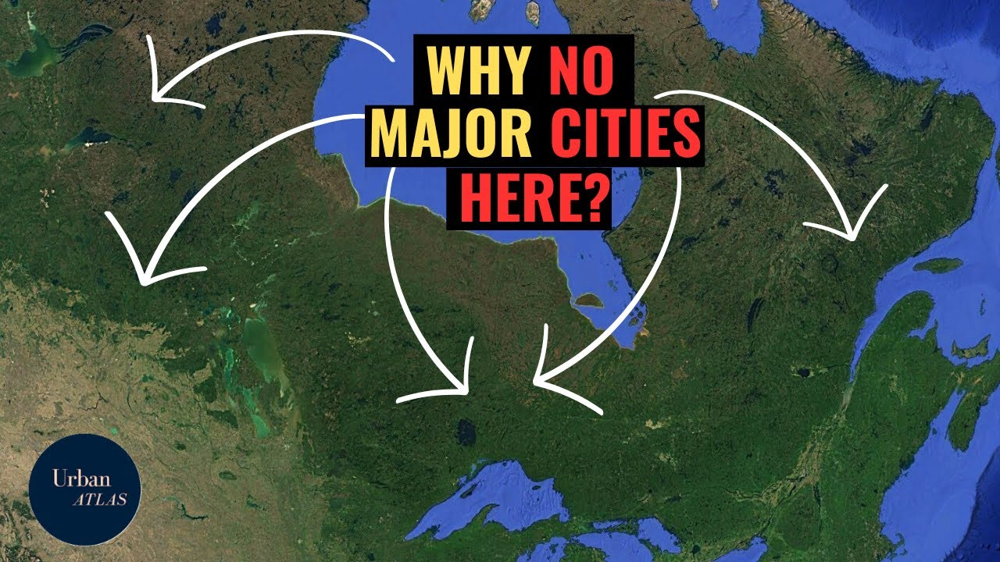

# Barely Anyone Lives in Northern Canada, Here’s Why.

Hello,

## Table of Contents

* [00:00:00] - Introduction
* [00:01:04] - The Canadian Shield
* [00:01:44] - The Geology and History of the Canadian Shield
* [00:03:55] - The Impact on Population Distribution
* [00:04:28] - Mining and Forestry
* [00:05:00] - Building on the Canadian Shield
* [00:06:17] - Frost Heaving
* [00:06:43] - The Layout of Shield Cities
* [00:07:45] - Sudbury, ON
* [00:08:57] - Thunder Bay, ON
* [00:09:53] - Adapting to the Shield
* [00:11:10] - The Paradox of the Shield

## [00:00:00] - Introduction

In most places around the world, digging a foundation means moving dirt. In cities on the Canadian shield, however, it means battling some of the hardest rock on the planet. It's the world's largest exposed section of pre-Camrian rock, formed up to 4 billion years ago when Earth was still cooling. And for thousands of years, indigenous peoples adapted to life on the Canadian shield. But when European settlers tried to build cities, they faced a stubborn opponent. [00:00:00 → 00:00:27]

To this day, every building, every road, every sewer pipe and foundation must battle this immovable force of nature. It's why construction on the Canadian shield cost billions more than similar projects elsewhere. Today, we explore the relentless geological enemy that has shaped Canada's urban geography, tested human ingenuity, and forced engineers to rethink how we build cities. This is the story of one of the Earth's oldest rock formations and humanity struggle to conquer it. And as always, this is Ellie and welcome back to Urban [Music] Atlas. [00:00:27 → 00:01:04]

## [00:01:04] - The Canadian Shield

To understand why the Canadian Shield presents such a challenge to urban development, we need to first grasp its sheer scale and composition. The Canadian Shield covers approximately 8 million square kilm, about half of Canada's land mass. It stretches from the Arctic Ocean to the Great Lakes and from Alberta to Labrador. Portions even extend into the United States in Minnesota, Wisconsin, and New York. From the air, the shield has a distinctive appearance. [00:01:04 → 00:01:30]

A seemingly endless mosaic of exposed bedrock, thin soil, coniferous forest, and countless lakes and rivers. This isn't just any rock. It's some of the oldest and the hardest rock on the planet. And the story of the Canadian shield begins around 4 billion years ago during Earth's precamrian era. [00:01:30 → 00:01:49]

## [00:01:44] - The Geology and History of the Canadian Shield

As the planet's molten surface began to cool and solidify, the area that would become the Canadian shield was among the first to form stable continental crust. The shield isn't a single type of rock, but rather a complex collection of ignous metamorphic and sedimentary rocks. Granite, nice, and basalt dominate the area. All known for their exceptional hardness and resistance to weathering. During the multiple ice ages over the past 2 million years, massive glaciers, some of which have been up to several kilometers thick, have moved across the shield. [00:01:47 → 00:02:19]

These glaciers scoured away most of the soil and weathered rock, exposing the hard bedrock beneath and carving out countless depressions that would eventually become the region's signature lakes. And when the glaciers retreated, they left behind a landscape with minimal soil cover. In many areas, the bedrock is completely exposed or covered by just a few inches of soil. This is a stark contrast to the fertile plains of southern Ontario or the Canadian prairies. Despite its challenges, the shield harbors immense mineral wealth. [00:02:19 → 00:02:50]

Gold, nickel, copper, zinc, uranium, and iron are all found here in abundance, leading to the establishment of important mining centers like Sudbury, Ontario, and Thompson, Manitoba. The irony is striking. The shield contains incredible riches beneath the surface, yet presents one of the most inhospitable environments for human settlement above ground. And this contradiction has shaped the entire pattern of urban development across Canada. But long before European contact, indigenous people have developed sophisticated strategies for living on the Canadian shield. [00:02:47 → 00:03:20]

The Anesnabi Cree and other First Nations recognized both the challenges and opportunities of this unique landscape. Rather than fighting the shield's rocky nature, they actually adapted to it. The countless lakes and rivers became transportation networks with established portage routes connecting waterways. They hunted and fished on the Canadian shield while permanent settlements were often established on the edges of the shield where agriculture was more viable. And when European explorers and fur traders arrived, they quickly discovered what indigenous people already knew, that the shield was not conducive to their conventional notions of settlement and agriculture. [00:03:20 → 00:03:53]

And this discovery which shaped Canada's entire population distribution. [00:03:53 → 00:03:57]

## [00:03:55] - The Impact on Population Distribution

Today, roughly 90% of Canadians live within 100 miles of the US border, a pattern largely dictated by geology. The Canadian Shield effectively pushed settlement into the narrow band of more hospitable land to the south. In the late 19th and early 20th centuries, government initiatives encouraged settlement and farming on shield lands in northern Ontario and Quebec. These efforts largely failed with settlers abandoning farms after discovering that the thin acidic soil and exposed bedrock made agriculture nearly impossible. Instead, shield settlements formed around resource extraction, primarily mining and forestry. [00:03:57 → 00:04:30]

## [00:04:28] - Mining and Forestry

Cities like Sudbury, Timmans, and Thunder Bay emerged not because the land was suitable for urban development, but because valuable resources beneath the surface made it economically viable to overcome the shield's challenges. Building a transcontinental Canadian Pacific Railway in the 1880s provided a stark demonstration of the shield's resistance to development. The section through the shield north of Lake Superior was one of the most difficult and expensive portions of the entire railway, requiring massive amounts of blasting and excavation through solid rock. And thus, building on the Canadian shield presents a unique set of engineering challenges that have tested human ingenuity and dramatically increased the cost of urban infrastructure. [00:04:30 → 00:05:10]

## [00:05:00] - Building on the Canadian Shield

Consider the simple act of digging a foundation. In most cities, excavation involves moving soil with conventional equipment. But on the shield, it requires drilling and blasting solid rock, a process that's exponentially more expensive, time-conuming, and technically challenging. This challenge extends to every aspect of urban infrastructure that typically goes underground. Water manes, sewer systems, utility tunnels, and service conduits. [00:05:10 → 00:05:36]

For example, the Susain Marie water main project completed in 2018 cost approximately $5 million per kilometer, nearly double the cost of similar projects in cities built on softer ground. And when Thunder Bay updated its aging infrastructure in the North Core district, specialized boring machines designed specifically for the Shields, Art Rock were required. Water and sewage infrastructure face similar challenges. In many shield cities, these systems must be built at shallow depths and with special insulation to prevent freezing during harsh winters. This is a design of necessity due to the difficulty of burying them deep in the bedrock. [00:05:36 → 00:06:13]

The combination of exposed bedrock and extreme temperature fluctuations also creates the problem of frost heaving. [00:06:13 → 00:06:20]

## [00:06:17] - Frost Heaving

You see, as the thin layer of soil above bedrock freezes and thaws, it can move structures built upon it, damaging foundations and roadways. Road construction in this region is particularly challenging. The exposed bedrock must be blasted and removed to create a level surface while drainage systems must be carefully engineered to prevent water accumulation on the non-absorbent rock surface. [00:06:20 → 00:06:43]

## [00:06:43] - The Layout of Shield Cities

The physical layout of shield cities reflects these challenges. Streets often follow a path of least resistance between rock outcroppings, creating irregular grid patterns, and buildings usually cluster in pockets where soil is deeper or the bedrock is more easily excavated. And as you can imagine, the financial impact is substantial. A 2016 study found that municipal infrastructure costs in shield cities average 15 to 40% higher than in comparable cities built on sedimentary plains or river valleys. Even residential construction is affected. [00:06:43 → 00:07:16]

Many older homes in shield regions lack full basements because excavating bedrock was more expensive for individual homeowners. Where basements do exist, they often follow the irregular contours of the bedrock, creating unusually shaped spaces. Paradoxically, the shield does provide one advantage for large institutional buildings, excellent foundation support. You see, Northern Ontario universities and hospitals built on bedrock have exceptional stability. The catch, of course, is that preparing the bedrock for the foundation work is extremely expensive. [00:07:14 → 00:07:45]

## [00:07:45] - Sudbury, ON

Perhaps no city better illustrates the challenges and adaptations of building on the shield than Sudbury, Ontario. Founded as a mining community after the discovery of nickel deposits in the late 19th century, Sudbury has been shaped by its geology in dramatic ways. Early Sudbury was a collective of mining camps clustered near various ore bodies. As it grew, development followed the valleys and depressions between rocky outcrops, creating an irregular urban pattern that still persists today. The city's mining activities so transformed the landscape that by the 1960s, Sudbury was famous for its barren, boomlike appearance. [00:07:45 → 00:08:22]

Sulfur dioxide emissions from smelting had killed vegetation and eroded what little soil existed, exposing even more bedrock. However, Sudbury's remarkable reging program, which has seen over 10 million trees planted since the 1970s, demonstrates both the challenges of the shield environment and the human perseverance in overcoming them. Today, Sudbury's urban infrastructure clearly reflects Shield constraints. Roads wind between rock outcroppings, neighborhoods cluster in pockets of deeper soil, and the cost of extending municipal services to new developments remains extraordinarily high due to the omnipresent bedrock. [00:08:20 → 00:08:58]

## [00:08:57] - Thunder Bay, ON

The city of Thunder Bay offers another perspective on Shield urban development. Worn from the merger of twin cities of Port Arthur and Fort Williams in 1970, Thunder Bay's geography illustrates how Shield conditions impacted city boundaries. The city stretches in a narrow band along Lake Superior. The Shield's rugged highlands rising sharply to the north and west. Urban expansion is physically constrained by this wall of ancient rock, channeling growth along the lake shore and into the few valleys cutting into the shield. [00:08:58 → 00:09:26]

Thunder Bay developed primarily as a transportation hub, a place where goods could be transferred between trains and ships at the western end of the Great Lakes. This economic function dictated its location at one of the few accessible points along the Shield's Lake Superior shoreline. The Shield's challenges have spurred remarkable innovations in construction and urban planning. Adaptations that demonstrate human ingenuity in the face of geologic obstacles. Canadian engineers have developed specialized techniques and equipment for shield conditions. [00:09:26 → 00:09:54]

## [00:09:53] - Adapting to the Shield

diamond tip drills, powerful rock breakers, and blasting methods tailored to various shield rock types. And in smaller shield cities, architects have increasingly embraced the rock rather than fighting it. Buildings that incorporate exposed bedrock as a design feature can be found in towns across northern Ontario and Quebec. Laurentian University in Sudbury famously incorporated existing rock outcroppings into its campus architecture and residential construction has adapted through shallow foundation techniques, slab ongrade construction and strategic building placement to minimize rock excavation. In some cases, buildings are literally anchored to the bedrock rather than attempting to dig into it. [00:09:54 → 00:10:33]

Modern urban planning in Shield Cities now emphasizes thorough geological surveying before development even begins. New subdivisions are designed to work with the natural topography rather than imposing rigid grid patterns that would require excessive rock removal. Green infrastructure approaches are particularly valuable in Shield cities. Perhaps the most successful adaptation has been the greater integration of natural features into urban planning. Rather than attempting to completely reshape the shield's topography, modern approaches work with it, preserving rock outcroppings as natural features and incorporating the shield's lakes and forests into urban green spaces. [00:10:33 → 00:11:10]

## [00:11:10] - The Paradox of the Shield

The Canadian Shield presents a paradox for urban development. It is simultaneously an obstacle to be overcome and a foundation on which many Canadian cities have been built. The Shield has directly shaped Canada's urban geography, not just in terms of where cities are located, but how they've been built and how they function. Perhaps most importantly, the Shield has enforced a certain humility in Canadian urban planning. In these cities, nature cannot be easily conquered or reshaped. [00:11:10 → 00:11:37]

Instead, successful development has come through respect for geological realities and the creative adaptation to them. The Canadian Shield cities stand as monuments to human perseverance. prove that even on the most unyielding foundation, we can build communities that last. These are cities literally carved from stone, and their very existent a testament to the determination of those who built them one difficult inch at a time. And as always, if you like content like this, remember to give this video a like. [00:11:35 → 00:12:05]

I'll catch you guys in the next one. Peace. [00:12:05 → 00:12:06]
